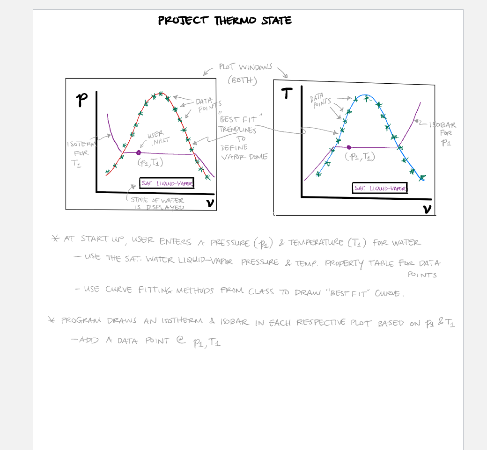

# Project Thermo State

Draws the vapor dome of water on a **p–v** and a **T–v** diagram.

At start-up the user enters a pressure p₁ and a temperature T₁ for water. The program then

1. plots the saturated-water table data points and a best-fit curve through them (the vapor dome),
2. draws the isotherm for T₁ on the p–v plot and the isobar for p₁ on the T–v plot,
3. marks the point (p₁, T₁) and displays the state of the water.



## Setup

Requires Python 3.9+.

```
git clone https://github.com/<your-username>/thermo-state.git
cd thermo-state
pip install -r requirements.txt
python main.py
```

Run the tests with `python -m pytest`.

## Project layout

| File | What goes in it | Owner |
|---|---|---|
| `main.py` | User input and the overall steps | |
| `thermo_state/data.py` | Load the CSV tables; Tsat(p) and psat(T) | |
| `thermo_state/fitting.py` | Curve-fitting methods from class | |
| `thermo_state/state.py` | State of water at (p₁, T₁) | |
| `thermo_state/curves.py` | Isotherm and isobar | |
| `thermo_state/plotting.py` | The two plots | |
| `data/` | Water tables as CSV (Moran, Tables A-2/A-3 saturated, A-4 superheated) | |
| `tests/` | Automated checks | |

Run everything from this folder (the one with `main.py`): the CSV paths are relative to it.

### Methods (all from ME 318M lectures)
- **Table look-ups:** linear interpolation (Week 2)
- **Vapor dome:** piecewise least-squares quadratic fits of ln(v) (Weeks 9–10), with a quadratic "cap" at the critical point
- **Superheated vapor:** Table A-4, double interpolation (in T inside each pressure block, then in P using P·v). Ideal-gas extension only outside the table: below 0.06 bar, or hotter than a block's last row
- **Compressed liquid:** `v ≈ vf(T)`
- **Plots:** `plt.subplot` + semilog-x axes (Week 5)

## Data

Everything is in SI units: T in °C, P in bar, v in m³/kg.
`data/sat_water_SI.csv` holds the temperature table (A-2) and the pressure table (A-3);
the `table` column says which one a row is from.
`data/superheated_water_SI.csv` is Table A-4 (superheated water vapor), one row per (P, T):
24 pressure blocks from 0.06 to 320 bar. Rows with `saturated = 1` are the book's "Sat." rows
(T = Tsat). Only `v` is used by the program; `u`, `h`, `s` are kept for reference. (The book's
h at 180 bar, 520 °C is printed as 3378.0 but u + Pv gives 3328.1, so it is probably a typo; it is
kept as printed.)

`vf` in the SI file is in m³/kg (the book prints vf × 10³). Values are as printed in
the book.

## Working together

- Make a branch for each task: `git checkout -b fitting`
- Commit, push (`git push -u origin fitting`), and open a Pull Request on GitHub.
- A teammate reviews, then merges. Before starting new work: `git checkout main` and `git pull`.
